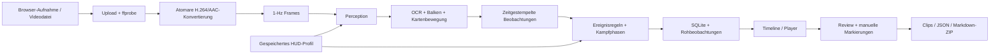

# Architektur

## Trennung

`vision.py` kennt keine Web-API und keinen Datenbankzugriff. `domain.py` ist reine, deterministische Logik auf Beobachtungen. `pipeline.py` verwaltet Videovorbereitung und Analyse. `store.py` kapselt SQLite-Verbindungen und additive Migrationen. `review.py` erzeugt manuelle Zeitdifferenzen und Berichte. `app.py` verbindet diese Komponenten mit HTTP und einer begrenzten lokalen Warteschlange; `static/` implementiert die Bedienung ohne Build-System.

## Zustand und Wiederholung

`queued → analyzing → ready` oder `failed`. Maximal vier angenommene Jobs, ein Analyseworker. Die Konvertierung schreibt zunächst eine temporäre MP4-Datei und benennt sie erst bei Erfolg um. Wiederholungsanalysen verwenden die bestehende normalisierte Datei. Erst nach erfolgreicher Analyse werden automatische Ereignisse transaktional ersetzt; eigene Markierungen und Notizen bleiben erhalten. Vorherige automatische Review-Bewertungen werden bewusst nicht auf neue, möglicherweise anders erkannte Ereignisse übertragen. Clips werden neu erzeugt. Ein Neustart markiert unterbrochene Jobs als fehlgeschlagen, damit sie explizit neu gestartet werden können.

Löschen und Neuplanung lehnen laufende Jobs ab. Kritische Review-/Clip-Änderungen sind gegen gleichzeitiges Löschen oder Neuplanung synchronisiert. SQLite-Verbindungen werden geschlossen und Transaktionen rollen bei Fehlern zurück. Dateien werden vor Löschung der Metadaten aus dem Match-Verzeichnis umbenannt, damit ein fehlgeschlagener Verzeichniszugriff nicht stillschweigend alle Metadaten entfernt.

## Wahrnehmung und Belege

OCR liest nur kalibrierte Ziffernbereiche. Die Vorverarbeitung hält gut aufgelöste Glyphen in nativer Größe; kleine Ausschnitte werden vergrößert, dunkle Hintergründe invertiert. Eine unnötige dreifache Vergrößerung führte im Test zu einer falschen Lesung von `25`; die Diagnose ist durch die vollständige Demo-Pipeline abgesichert.

Balkenmessung zählt farbig/hell belegte Spalten im kalibrierten Inneren eines HUD-Balkens. Eine leere Farbbelegung gilt als unbekannt statt als sichere Null. Minimap-Bewegung nutzt Feature-Tracking und eine RANSAC-Affintransformation. Erkennbarer Zoom oder Rotation wird verworfen; das ist keine vollständige Kartenrekonstruktion. Große globale Bildänderungen unterbrechen Counter-Verknüpfungen und Bewegungssegmente.

Jeder automatische Befund enthält Zeitfenster, Messwerte, Quellenbeschreibung und Einschränkung. Zusammengesetzte Hinweise referenzieren die Signalzeitfenster. Manuelle Sichtkontakt-/Schuss-Markierungen erzeugen lediglich Video-Zeitdifferenzen. Weder diese noch das 1-Hz-Sampling messen kognitive Reaktion.

## Privater Betrieb

Kein Netzwerkaufruf oder Modell-Download für die Analyse. Aufnahme erfolgt über die explizite Browser-Quellenfreigabe. Dateien werden lokal gespeichert. Die Anwendung bindet an Loopback, hat keine Nutzerverwaltung und ist nicht für öffentliches Hosting eingerichtet. Fremde HTTP-Origins können keine schreibenden Browser-Anfragen senden. Nutzereingaben erscheinen über `textContent`, SQL nutzt Parameter und FFmpeg wird ohne Shell gestartet. Keine Ausführung hochgeladener Programme.

## Weiterentwicklung der Erkennung

Gelabelte Originalclips sind Voraussetzung für gemessene Erkennungsraten. Exportierte Review-Labels sind ein Ausgangspunkt, kein automatisch korrekter Trainingsdatensatz. Separate Auswertung für HUD-Versionen, Auflösungen, Spectator-Sichten, Bildschnitte, Kartenrotation, Waffenwechsel und fehlende OCR. Ein lokales ONNX-/anderes Modell kann das `Perception`-Protokoll implementieren. Modellspezifische Abhängigkeiten bleiben im Adapter; die bestehenden Modelle werden nicht durch einen nicht vorhandenen KI-Dienst ersetzt.
